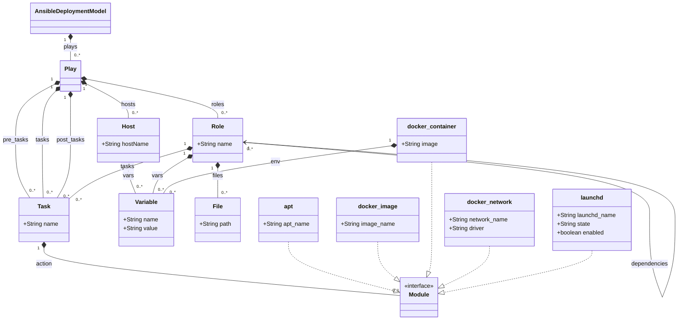

# Ansible Transformations

The Ansible transformation is implemented by two repositories:

- [**ansible-mps-plugin**](https://github.com/UST-DeMAF/ansible-mps-plugin): The DeMAF plugin service that parses the Ansible deployment model (*Step 1: Deployment Model Parser*), runs the MPS transformation, merges its result into the EDMM model (*Step 3: Model Merger*), and requests the analysis of embedded deployment models.
- [**mps-transformation-ansible**](https://github.com/UST-DeMAF/mps-transformation-ansible): The JetBrains MPS project that defines the Ansible metamodel (language `Ansible`) and the generator that implements the *Main M2M Transformation* (Step 2).

## Ansible Metamodel

The following diagram shows the Ansible metamodel as supported by the DeMAF:

The metamodel shows the part of the `Ansible` language of the MPS project that is parsed and transformed by the DeMAF.
Role dependencies are stored as role names in the MPS language.
`Module` represents the action of a task; its subtypes represent the supported Ansible modules.

## Transformation Process

The transformation follows the four steps of the DeMAF transformation process: the deployment model parser, the main model-to-model (M2M) transformation, the model merger, and the post M2M transformation.

### Step 1: Deployment Model Parser

The parser reads the playbooks at the given locations, which must be files with the extension `.yaml` or `.yml`.
A playbook is parsed as a list of plays; plays with the same name as a previously parsed play replace it.

For each play, the parser reads:

- **Hosts**: The inventory is read from the file `hosts.yaml` or `hosts.yml` in the directory of the playbook. It is expected to be structured as `<group>: hosts: <host name>: <variable>: <value>`. The hosts are filtered by the `hosts` of the play, which may be `all`, a host name, a group name, or a list of host names and group names. If no host matches, all hosts of the inventory are used.
- **Tasks**: The `pre_tasks`, `tasks`, and `post_tasks` of the play.
- **Roles**: For each role in `roles` (given as `- role: <name>`), the files `roles/<name>/{tasks,vars,defaults,meta}/main.yaml` relative to the playbook are read. The dependencies are read from the `dependencies` in `meta/main.yaml`. All files in `roles/<name>/files` (including subdirectories) are added as files of the role.
- **Variables**: The `vars` of the play, of the roles (`vars/main.yaml`), of the role defaults (`defaults/main.yaml`), of the hosts, and of the tasks. Only variables with a string value or a list of string values are parsed.

For each task, the parser reads the `name` and the action module.
The following modules are parsed:

| Module key in the task | Parsed into |
| --- | --- |
| `docker_container` | `docker_container` |
| `docker_image` | `docker_image` |
| `docker_network` | `docker_network` |
| `apt` | `apt` |
| `community.general.launchd` | `launchd`; a `name` of `{{ item }}` is replaced by the values of the task's `loop` |

Tasks with any other module are parsed without an action and are transformed into operations without artifacts.

After parsing, references to variables in the form `{{ <variable name> }}` are replaced by the variable values, in the following order: the variables of the task and its role, the role defaults, and the variables of the play.

### Step 2: Main M2M Transformation

The plugin serializes the parsed Ansible model to XML, which is imported and transformed into an EDMM model by the generator of the MPS project.

#### Overview of Mappings

| Ansible Construct | EDMM Construct |
| --- | --- |
| Ansible Deployment Model | Base Component Type & Relation Types |
| Host (of a play) | Component & Component Type |
| Role | Component & Component Type |
| Roles and Hosts in the same Play | hosted-on Relation |
| Role Dependency | connects-to Relation |
| Variable | Component Property |
| Task | Operation |
| Module | Operation Artifact |
| `docker_container` Module | Component Artifact & Component Property |
| File | Component Artifact |

#### Details

##### Ansible Deployment Model

For each transformed Ansible deployment model, the component type `BaseType` and the relation types `DependsOn`, `HostedOn`, and `ConnectsTo` are created, where `HostedOn` and `ConnectsTo` are derived from `DependsOn`.

##### Host

Each host of a play is mapped to:

- A **component** with the host name. It gets
  - a property for each variable of the host,
  - an operation for each task of the play's `pre_tasks`, `tasks`, and `post_tasks` (see [Task and Module](#task-and-module)), and
  - an artifact of type `docker_image` for each `docker_container` task in the `tasks` of the play.
- A **component type** `<host name>-type` derived from `BaseType` with the variable names of the host as property keys.

##### Role

Each role of a play is mapped to:

- A **component** with the name of the role. It gets
  - a property for each variable of the role (`vars/main.yaml`) and for each environment variable (`env`) of a `docker_container` task of the role,
  - an operation for each task of the role (see [Task and Module](#task-and-module)),
  - an artifact of type `docker_image` for each `docker_container` task of the role, and
  - an artifact of type `file` for each file of the role, named after the file with the file URI `file:<absolute path>`.
- A **component type** `<role name>-type` derived from `BaseType` with the environment variables of the `docker_container` tasks of the role as properties.

##### Roles and Hosts in the same Play

For each role and each host of the same play, a **hosted-on relation** `<role name>_hostedOn_<host name>` is created from the component of the role to the component of the host.

##### Role Dependency

For each dependency of a role, a **connects-to relation** `<role name>_connectsTo_<dependency>` is created from the component of the role to the component of the role with the name of the dependency in the same play.

##### Task and Module

Each task is mapped to an **operation** with the name of the task.
Depending on the module of the task, the operation gets the following artifacts:

| Module | Artifacts of the operation |
| --- | --- |
| `docker_container` | `docker_image` artifact named after the `image`, and `bash` artifact `/bin/sh docker run <image>` |
| `docker_image` | `docker_image` artifact named after the image `name`, and `bash` artifact `/bin/sh docker pull <name>` |
| `docker_network` | `bash` artifact `/bin/sh docker network create -d <driver> <name>` |
| `apt` | `apt` artifact named after the package `name` |
| `launchd` | `launchd` artifact named `<name>`, extended by `enabled` and the `state` if set |
| any other module | none |

The file URI of these artifacts is `-`.

### Step 3: Model Merger

The plugin merges the result of the MPS transformation into the EDMM model of the current transformation process:

- Components and relations are added to the existing ones.
- Component types and relation types with the same name are merged. Components and relations of the merged type are changed to use the existing type, and properties and operations that are not present are added to the existing component type.

### Step 4: Post M2M Transformation

There is no post M2M transformation.

## Embedded Deployment Models

The DeMAF currently supports the following embeddings of Ansible deployment models, which are described in detail in the [overview of embedded deployment models](README.md#embedded-deployment-models):

- [Ansible → Docker](README.md#ansible--docker) (reference embedding)
