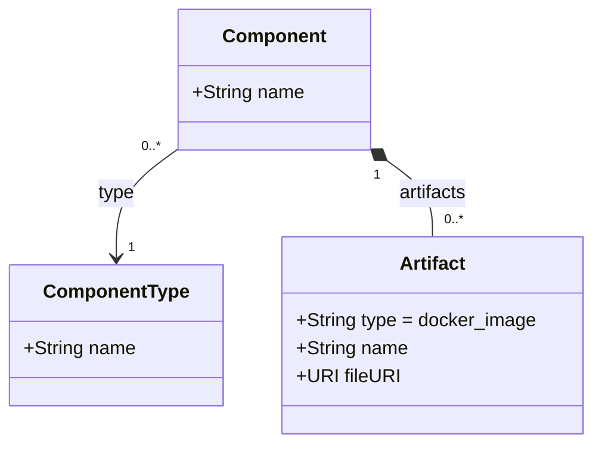

# Docker Transformations

The Docker transformation is implemented by the [**docker-plugin**](https://github.com/UST-DeMAF/docker-plugin).
In contrast to the other plugins, it does not parse a deployment model.
Instead, it analyzes the Docker images of components that other plugins have already created in the EDMM model and refines the component types of these components.
Thus, Docker is always analyzed as an embedded deployment model of another deployment technology (see [Embedded Deployment Models](#embedded-deployment-models)).

## Docker Metamodel

The plugin does not define a metamodel of its own.
Its input is the part of the EDMM model that describes a Docker image used by a component:

A Docker image is an artifact of type `docker_image`, whose name is the image reference, e.g., `postgres:12.16` or `ghcr.io/example/backend:latest`.

## Transformation Process

The plugin receives the IDs of the components to analyze from the analysis task, which is created by the embedding plugin.
For each of these components, it runs the steps described below and updates the EDMM model of the transformation process.
The analysis does not use a JetBrains MPS project.

### 1. Component Type Classification

The image identifier is derived from the name of the first `docker_image` artifact of the component: the registry and namespace before the last `/` and the tag after `:` are removed.
For example, the image `ghcr.io/example/backend:latest` results in the identifier `backend`, and `postgres:12.16` results in `postgres`.

The image identifier is classified by the following lists, which are configured in the `application.properties` of the plugin:

| Classification | Image identifiers |
| --- | --- |
| `DatabaseSystem` | `aerospike`, `arangodb`, `cassandra`, `couchbase`, `couchdb`, `crate`, `elasticsearch`, `influxdb`, `mariadb`, `memcached`, `minio`, `mongo`, `mongodb`, `mysql`, `neo4j`, `orientdb`, `postgres`, `postgresql`, `redis`, `rethinkdb`, `valkey` |
| `MessageBroker` | `eclipse-mosquitto`, `emqx`, `kafka`, `lightstreamer`, `nats`, `rabbitmq` |
| `SoftwareApplication` | all other image identifiers |

If not present yet, the component types `SoftwareApplication` (derived from `BaseType`), `DatabaseSystem`, and `MessageBroker` (both derived from `SoftwareApplication`) are created.
The EDMM model must contain the component type `BaseType`, which is created by the transformations of the embedding deployment technologies.

The component then gets the component type `<image identifier>-<classification>`, e.g., `postgres-DatabaseSystem` or `backend-SoftwareApplication`, which is derived from the classification type:

- If a component type with this name already exists, the component uses it. The properties and operations of the previous component type are added to it if not present, and the previous component type is removed if it is no longer used.
- Otherwise, if the previous component type of the component is also used by other components, a new component type is created with the properties of the component and the operations of the previous component type.
- Otherwise, the previous component type is renamed and gets the properties of the component.

Thus, all components using the same image share the same component type.

### 2. Image FileURI Refinement

The file URI of each `docker_image` artifact is set, if it is not set or `-`:

| Image reference | File URI |
| --- | --- |
| Official image, e.g., `postgres:12.16` | `https://hub.docker.com/_/postgres` |
| Docker Hub image with prefix, e.g., `docker.io/example/backend:latest` | `https://hub.docker.com/r/example/backend` |
| Image of another registry, e.g., `ghcr.io/example/backend:latest` | the image reference itself |
| Other images with namespace, e.g., `example/backend:latest` | `https://hub.docker.com/r/example/backend` |

## Embedded Deployment Models

The DeMAF currently supports the following embeddings of Docker deployment models, which are described in detail in the [overview of embedded deployment models](README.md#embedded-deployment-models):

- [Ansible → Docker](README.md#ansible--docker) (reference embedding)
- [Kubernetes → Docker](README.md#kubernetes--docker) (reference embedding)
- [Terraform → Docker](README.md#terraform--docker) (reference embedding)
