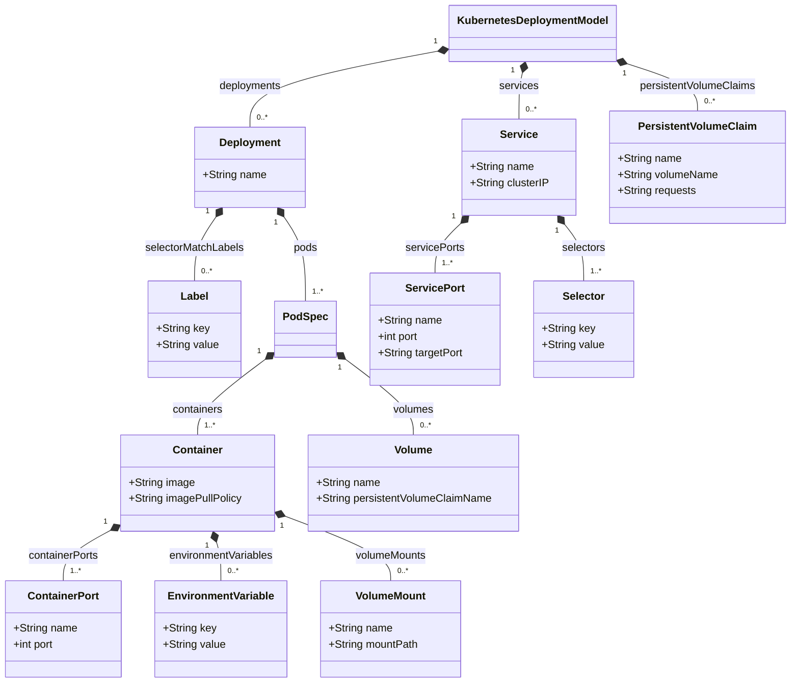

# Kubernetes Transformations

The Kubernetes transformation is implemented by two repositories:

- [**kubernetes-mps-plugin**](https://github.com/UST-DeMAF/kubernetes-mps-plugin): The DeMAF plugin service that parses the Kubernetes deployment model (*Step 1: Deployment Model Parser*), runs the MPS transformation, and requests the analysis of embedded deployment models.
- [**mps-transformation-kubernetes**](https://github.com/UST-DeMAF/mps-transformation-kubernetes): The JetBrains MPS project that defines the Kubernetes metamodel (language `Kubernetes`) and the generators that implement the *Main M2M Transformation* (Step 2), the *Model Merger* (Step 3), and the *Post M2M Transformation* (Step 4).

## Kubernetes Metamodel

The following diagram shows the Kubernetes metamodel as supported by the DeMAF:

The metamodel shows the part of the `Kubernetes` language of the MPS project that is parsed and transformed by the DeMAF (`Label` is named `StringStringMap` there).
`Deployment` represents deployments, stateful sets, and replica sets.

## Transformation Process

The transformation follows the four steps of the DeMAF transformation process: the deployment model parser, the main model-to-model (M2M) transformation, the model merger, and the post M2M transformation.

### Step 1: Deployment Model Parser

The parser reads the `.yaml` and `.yml` files at the given locations; for a directory, the files directly contained in it are read (subdirectories are not searched).
A file can contain several documents separated by `---`.
Each document is read from its top-level `kind` line up to the next `---`, so fields placed above `kind` (e.g., `metadata`) are ignored.
The document is parsed based on its Kubernetes `kind`:

| `kind` | Parsed into |
| --- | --- |
| `Deployment`, `StatefulSet`, `ReplicaSet` | `Deployment` with its `PodSpec`. The `volumeClaimTemplates` of a StatefulSet are parsed into `PersistentVolumeClaim`s and corresponding `Volume`s (see [Persistent Storage](#persistent-storage)). |
| `Service` | `Service` |
| `PersistentVolumeClaim` | `PersistentVolumeClaim` |

Documents of other kinds are not transformed.
While parsing, references to other environment variables of the same container (`$(VAR_NAME)`) are replaced by the referenced value.

### Step 2: Main M2M Transformation

The plugin serializes the parsed Kubernetes model to XML, which is imported and transformed into an EDMM model by the generator of the MPS project.

#### Overview of Mappings

| Kubernetes Object | EDMM Construct |
| --- | --- |
| Kubernetes Deployment Model | Base Component Types & Relation Types, `defaultKubernetesCluster` Component |
| Pod (in Deployment / Stateful Set) | Component & Component Type, hosted-on Relation |
| Container Port | Component Property |
| Environment Variable | Component Property & connects-to Relation |
| Container Image | Component Artifact & Component Type |
| Image Pull Policy | Component Property |
| Service Port | Component Property |
| PVC & Volume & Volume Mount | Component & attaches-to Relation, hosted-on Relation |

#### Details

##### Kubernetes Deployment Model

For each transformed Kubernetes deployment model, the following types are created:

- Relation types `DependsOn`, `ConnectsTo`, and `HostedOn`, where `ConnectsTo` and `HostedOn` are derived from `DependsOn`.
- Component types `BaseType`, `ContainerPlatform` (derived from `BaseType`), `KubernetesCluster` (derived from `ContainerPlatform`), and `DefaultKubernetesCluster` (derived from `KubernetesCluster`).
- If the model contains at least one PVC: The relation type `AttachesTo` (derived from `DependsOn`) with the required property `location`, and the component type `Storage` (derived from `BaseType`) with the required property `storage_size`.

In addition, a component `defaultKubernetesCluster` of type `DefaultKubernetesCluster` is created.
It represents the Kubernetes cluster that hosts all created components until the actual cluster is known (see [Step 4: Post M2M Transformation](#step-4-post-m2m-transformation)).

##### Pod (in Deployment / Stateful Set)

Deployment and stateful set objects specify the workload in the form of a pod running on the Kubernetes cluster.
Each `Deployment` (including stateful sets and replica sets) is mapped to:

- A **component** with the name of the deployment.
- A **component type** `<deployment name>-type` derived from `BaseType`.
  It contains the same property keys as the component.
  The type may be refined later based on the container image (see [Container Image](#container-image)).
- A **hosted-on relation** `<deployment name>_HostedOn_defaultKubernetesCluster` to the `defaultKubernetesCluster` component.

The properties and artifacts of the component are derived from the containers of the pod specification, as described below.

If several containers result in properties with the same key, properties with identical values are merged into one property.
Properties with different values are kept, and their keys are suffixed with `_<value>` to make them unique.

##### Container Port

Each container port of a container becomes a component property of type `INTEGER`:

- Key: `containerPort`, followed by `_<port name>` if the port has a name.
- Value: the port number.

For example, `- containerPort: 5432` results in the property `containerPort: 5432`.

##### Environment Variable

Each environment variable of a container that has a literal `value` becomes a required component property with the variable name as key and the variable value as value.
Single quotes enclosing the value are replaced by double quotes.

Environment variables are also used to detect **connects-to relations**.
Kubernetes allows the implicit configuration of pod connections in environment variables that reference the name of a service object.
Since the software running in the container defines the naming scheme of the environment variables, this requires a semantic analysis:

1. Each `Service` is matched to the deployments it exposes: A service matches a deployment if each key-value pair of the service `selector` is contained in the deployment's `selector.matchLabels`.
2. An environment variable is considered a connection if its key contains one of the keywords `connect`, `host`, `server`, `url`, `uri`, `service`, `addr`, or `endpoint` (case-insensitive) and its value contains the name of a matched service.
   If several service names are contained, the longest one is chosen.
3. A connects-to relation `<source>_ConnectsTo_<target>` is created from the component of the deployment that defines the environment variable to the component of the deployment matched by the service.
   Relations from a deployment to itself are not created, and for each deployment only one relation to each target is created.

For example, the environment variable `SPRING_DATASOURCE_URL: jdbc:postgresql://postgres:5432/postgres` of the `backend` deployment contains the keyword `url` and the name of the `postgres` service.
Thus, the relation `backend_ConnectsTo_postgres` is created.

Connections are also detected across transformation processes, for example, if the Kubernetes manifests are spread across several embedded deployment models.
For this, the plugin passes the Kubernetes model of previous transformation processes of the same analysis to the MPS transformation.
Environment variables of newly transformed deployments that reference services of previously transformed deployments result in connects-to relations to the existing components, and vice versa.

##### Container Image

Each container of the pod specification is mapped to an **artifact** of the component:

- Type: `docker_image`
- Name: the container image, e.g., `postgres:12.16`
- File URI: `-`

For each newly created component with a `docker_image` artifact, the Kubernetes plugin requests an analysis by the Docker plugin.
The Docker plugin derives the component type from the image name without registry and tag, e.g., `postgres` for `postgres:12.16`.
It classifies the image as `DatabaseSystem` (e.g., PostgreSQL, MySQL, or MongoDB), `MessageBroker` (e.g., Kafka or RabbitMQ), or otherwise `SoftwareApplication`, and assigns the component type `<image name>-<classification>`, e.g., `postgres-DatabaseSystem`.
Thus, components using the same image share the same component type.
In addition, the Docker plugin replaces the file URI `-` with the URI of the image, e.g., on Docker Hub.
See the Docker transformation for details.

##### Image Pull Policy

The `imagePullPolicy` of each container becomes the component property `imagePullPolicy`.
If no image pull policy is specified, the parser uses the default `IfNotPresent`.

##### Service Port

Services are not mapped to components.
Instead, their ports are added to the components of the deployments they expose (see the service matching in [Environment Variable](#environment-variable)).
Each service port becomes a required component property:

- Key: `exposedPort`, followed by `_<port name>` if the service port has a name.
- Value: `<service port>:<container port>`, where the container port is the container port of the deployment that matches the `targetPort` of the service port by number or name. If no `targetPort` is specified, the service port is used.

Service ports are only mapped if the target port matches a container port of the deployment.
Headless services (`clusterIP: None`) are ignored.

For example, the `postgres` service with `port: 5432` and `targetPort: 5432` results in the property `exposedPort: 5432:5432` of the `postgres` component.

##### Persistent Storage

Kubernetes provides objects to deploy persistent storage for containers, namely the *Persistent Volume Claim (PVC)*, *Volume*, and *Volume Mount*.
A PVC matches a volume of a pod specification if the volume references the claim (`persistentVolumeClaim.claimName`) or if the claim references the volume (`volumeName`).
Each PVC is matched to the first matching volume only.
For a `volumeClaimTemplate` of a stateful set, the parser creates a PVC named `<stateful set name>-<template name>` and a matching volume named `<template name>` in the pod specification.

Each matched pair of PVC and volume is mapped to:

- A **component** of type `Storage` with the property `storage_size`, which is set to the requested storage of the PVC (`resources.requests.storage`).
  It is named `<PVC name>-volume` if the PVC name ends with the volume name, otherwise `<PVC name>-<volume name>-volume`.
- An **attaches-to relation** from the storage component to the component of the deployment whose pod specification contains the volume.
  The relation has the property `location`, which is set to the `mountPath` of the volume mount that references the volume.
  It is named `<PVC name>-mount` or `<PVC name>-<volume name>-mount`, analogous to the component.
- A **hosted-on relation** from the storage component to the `defaultKubernetesCluster` component.

### Step 3: Model Merger

After the main M2M transformation, the result is merged into the EDMM model of the current transformation process:

- Components with the same name and component type name are merged into one component that contains the properties, operations, and artifacts of both. Relations of the merged components are redirected accordingly.
- Component types and relation types with the same name are merged.
- **Kubernetes objects**: If the existing EDMM model contains the component type `kubernetes_deployment`, a new component that is not merged as described above replaces the existing component whose component type starts with `kubernetes_` and whose property `metadata.name` equals the name of the new component.
  For example, the Terraform transformation creates such components for resources of the Terraform Kubernetes provider, e.g., a `kubernetes_deployment` resource.
- **Helm charts**: If the existing EDMM model contains the component type `helm_release`, a new component that is not merged as described above replaces an existing `helm_release` component whose property `name` is a prefix of the name of the new component, unless another new component has exactly that name.
  If several `helm_release` components match, only the one whose `name` property equals the name of the new component (if any) is replaced.
  For example, the Terraform transformation creates such components for `helm_release` resources of the Terraform Helm provider.

When a component is replaced, its relations are redirected to the new component and renamed to `<source>_<relation type>_<target>`.
The replaced component is removed, as is its component type if no other component uses it.

### Step 4: Post M2M Transformation

The post M2M transformation replaces the `defaultKubernetesCluster` component with the actual Kubernetes cluster if it is known.
A component is considered a Kubernetes cluster if its component type is `KubernetesCluster` or derived from it.
If the merged EDMM model contains another Kubernetes cluster besides `defaultKubernetesCluster`, for example, the `google_container_cluster` created by a Terraform deployment model:

- all hosted-on relations to `defaultKubernetesCluster` are redirected to that cluster component and renamed accordingly, and
- the `defaultKubernetesCluster` component and the `DefaultKubernetesCluster` component type are removed.

## Embedded Deployment Models

The DeMAF currently supports the following embeddings of Kubernetes deployment models, which are described in detail in the [overview of embedded deployment models](README.md#embedded-deployment-models):

- [Bash → Kubernetes](README.md#bash--kubernetes) (reference embedding)
- [Helm → Kubernetes](README.md#helm--kubernetes) (containment embedding)
- [Kubernetes → Docker](README.md#kubernetes--docker) (reference embedding)
- [Terraform → Kubernetes](README.md#terraform--kubernetes) (containment embedding)
