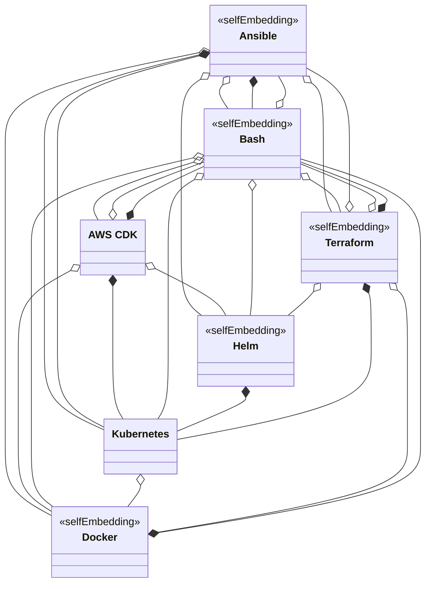

# DeMAF Transformations

This documentation describes in detail the transformations carried out by the DeMAF for each supported deployment technology.
Technology-specific deployment models of these deployment technologies are transformed into a unified, technology-agnostic deployment model based on the Essential Deployment Metamodel (EDMM).

We currently support the transformation of the following deployment technologies, explained in detail in separate files:

| Deployment Technology | Transformation Documentation | Dev Version |
| --- | --- | --- |
| Ansible | [Ansible](Ansible.md) | [Ansible-DEV](dev/Ansible-dev.md) |
| Bash | [Bash](Bash.md) | [Bash-DEV](dev/Bash-dev.md) |
| Docker | [Docker](Docker.md) | - |
| Helm | [Helm](Helm.md) | [Helm-DEV](dev/Helm-dev.md) |
| Kubernetes | [Kubernetes](Kubernetes.md) | [Kubernetes-DEV](dev/Kubernetes-dev.md) |
| Terraform | [Terraform](Terraform.md) | [Terraform-DEV](dev/Terraform-dev.md) |
| AWS Cloud Development Kit (CDK) | [AWS CDK](AWSCDK.md) | [AWSCDK-DEV](dev/AWSCDK-dev.md) |

For some deployment technologies, we provide a dev-version that reflects the current implementation state including where features are unfinished or need improvement.

Each file describes the technology-specific metamodel of the deployment technology, the mappings and transformation rules from this technology-specific metamodel to the EDMM, and which and how embedded deployment models are detected.
In addition, it gives details on how this transformation is carried out. The transformation of most deployment technologies is carried out in 4 general steps:

- Step 1: Deployment Model Parser
- Step 2: Main M2M Transformation
- Step 3: Model Merger
- Step 4: Post M2M Transformation

## EDMM

Here, we describe how the DeMAF implements the Essential Deployment Metamodel (EDMM).
The DeMAF uses a general type system for Component and Relation types that we document in [**DeMAF Type Definitions**](<https://github.com/UST-DeMAF/demaf-type-definitions>).

## Embedded Deployment Models

Often, a mix of deployment technologies are used to deploy software systems.
To this end, deployment technologies provide means to embed the deployment models of other deployment technologies, leading to what we call **heterogenuously nested deployment models**.
Moreover, we refer to the overall deployment model of the software system that contains all embedded deployment mdoels as the **system deployment model**.
We distinguish between two different methods by which one deployment model can embed another deployment model:

**Reference Embedding**:
The embedding deployment model references an external location where the embedded deployment model is defined (for example, a file).

**Containment Embedding**:
The embedded deployment model is specified directly in the embedding deployment model.

A deployment technology can provide means to embed deployment models using either one or both of these methods.
The following table shows the methods provided by the deployment technologies to embed deployment models and which of them are currently detected by the DeMAF.

| embeds → | Ansible | AWS CDK | Bash | Docker | Helm | Kubernetes | Terraform |
| --- | :-: | :-: | :-: | :-: | :-: | :-: | :-: |
| **Ansible** | [R](#ansible--ansible) | | [R, C](#ansible--bash) | **[R](#ansible--docker)** | [R](#ansible--helm) | [R, C](#ansible--kubernetes) | [R](#ansible--terraform) |
| **AWS CDK** | | | [R, C](#aws-cdk--bash) | [R](#aws-cdk--docker) | [R](#aws-cdk--helm) | [C](#aws-cdk--kubernetes) | |
| **Bash** | [R](#bash--ansible) | [R](#bash--aws-cdk) | [R](#bash--bash) | [R](#bash--docker) | **[R](#bash--helm)** | **[R](#bash--kubernetes)** | **[R](#bash--terraform)** |
| **Docker** | | | [C](#docker--bash) | [R](#docker--docker) | | | |
| **Helm** | | | | | [R](#helm--helm) | **[C](#helm--kubernetes)** | |
| **Kubernetes** | | | | **[R](#kubernetes--docker)** | | | |
| **Terraform** | [R](#terraform--ansible) | | [R, C](#terraform--bash) | **[R](#terraform--docker)** | **[R](#terraform--helm)** | **[C](#terraform--kubernetes)** | [R](#terraform--terraform) |

R = reference embedding, C = containment embedding, **bold** = detected by the DeMAF

The following subsections explain each embedding in more detail, including technical means and constructs the embedding deployment technology provides to achieve it and how the DeMAF detects this embedding, if applicable.

### Ansible

Documentation: [Ansible Documentation](https://docs.ansible.com/)

Ansible mostly embeds deployment models through dedicated [modules](https://docs.ansible.com/projects/ansible/latest/getting_started/basic_concepts.html#modules) provided in official or community [collections](https://docs.ansible.com/projects/ansible/latest/collections/index.html).

#### Ansible → Ansible

**Reference embedding**: A playbook can include playbooks, task files, and roles that are defined in separate files and are executed as part of the playbook.

- [`ansible.builtin.import_playbook`](https://docs.ansible.com/ansible/latest/collections/ansible/builtin/import_playbook_module.html) imports another playbook file.
- [`ansible.builtin.import_tasks`](https://docs.ansible.com/ansible/latest/collections/ansible/builtin/import_tasks_module.html) and [`ansible.builtin.include_tasks`](https://docs.ansible.com/ansible/latest/collections/ansible/builtin/include_tasks_module.html) import task files statically or dynamically.
- The [`roles` keyword](https://docs.ansible.com/ansible/latest/playbook_guide/playbooks_reuse_roles.html) of a play, [`ansible.builtin.import_role`](https://docs.ansible.com/ansible/latest/collections/ansible/builtin/import_role_module.html), and [`ansible.builtin.include_role`](https://docs.ansible.com/ansible/latest/collections/ansible/builtin/include_role_module.html) execute roles, which are stored in separate directories or installed from Ansible Galaxy.

#### Ansible → Bash

**Reference embedding**: A task executes a shell script that is stored in a separate file.

- [`ansible.builtin.script`](https://docs.ansible.com/ansible/latest/collections/ansible/builtin/script_module.html) transfers a local script to the managed host and executes it there.

**Containment embedding**: A task contains shell commands that are executed on the managed host.

- [`ansible.builtin.shell`](https://docs.ansible.com/ansible/latest/collections/ansible/builtin/shell_module.html) executes a command through a shell (`/bin/sh` by default, configurable with `executable`), including pipes, redirects, and multi-line scripts.
- [`ansible.builtin.command`](https://docs.ansible.com/ansible/latest/collections/ansible/builtin/command_module.html) executes a command without a shell, i.e., without shell features such as pipes or environment variable expansion.

#### Ansible → Docker

**Reference embedding**: A task runs containers from or builds Docker images, which are defined by a Dockerfile in a separate file or are published in a registry.

- [`community.docker.docker_container`](https://docs.ansible.com/ansible/latest/collections/community/docker/docker_container_module.html) runs a container from the image given by `image`.
- [`community.docker.docker_image`](https://docs.ansible.com/ansible/latest/collections/community/docker/docker_image_module.html) pulls an image (`source: pull`) or builds it from a Dockerfile in the directory given by `build.path` (`source: build`).

**Detection**: For roles and hosts of plays with `docker_container` tasks, the DeMAF requests the analysis of the referenced image by the Docker plugin.

#### Ansible → Helm

**Reference embedding**: A task installs a Helm chart that is stored in a chart repository or in a local directory.

- [`kubernetes.core.helm`](https://docs.ansible.com/ansible/latest/collections/kubernetes/core/helm_module.html) installs a release of the chart given by `chart_ref` (a chart in an added repository, a local path, or a URL), optionally with `chart_repo_url` and `chart_version`.
  Values can be contained in the task (`release_values`, `set_values`) or referenced (`values_files`).
- [`kubernetes.core.helm_repository`](https://docs.ansible.com/ansible/latest/collections/kubernetes/core/helm_repository_module.html) adds a chart repository.

#### Ansible → Kubernetes

**Reference embedding**: A task applies Kubernetes manifests that are stored in separate files.

- [`kubernetes.core.k8s`](https://docs.ansible.com/ansible/latest/collections/kubernetes/core/k8s_module.html) with `src` applies the manifest file at the given path.
- [`kubernetes.core.k8s`](https://docs.ansible.com/ansible/latest/collections/kubernetes/core/k8s_module.html) with `template` renders a Jinja2 template of a manifest and applies it.

**Containment embedding**: A task contains Kubernetes objects directly in the playbook.

- [`kubernetes.core.k8s`](https://docs.ansible.com/ansible/latest/collections/kubernetes/core/k8s_module.html) with `resource_definition` (alias `definition`) applies the Kubernetes objects specified inline in YAML.

#### Ansible → Terraform

**Reference embedding**: A task applies a Terraform configuration that is stored in a separate directory.

- [`community.general.terraform`](https://docs.ansible.com/ansible/latest/collections/community/general/terraform_module.html) runs `terraform apply` (or `destroy`) for the configuration in `project_path`, with input variables given by `variables` or `variables_files`.

### AWS CDK

Documentation: [AWS CDK Developer Guide](https://docs.aws.amazon.com/cdk/v2/guide/home.html), [AWS CDK API Reference](https://docs.aws.amazon.com/cdk/api/v2/)

The AWS CDK plugin analyzes the synthesized cloud assembly (`cdk.out`) instead of the CDK source code.
Thus, an embedding becomes visible only if the CDK constructs leave a trace in the synthesized CloudFormation templates or asset manifests.
This is the case for all embeddings described below.

#### AWS CDK → Bash

**Reference embedding**: An EC2 instance executes a shell script that is stored in a separate file when it boots.

- [`UserData.addS3DownloadCommand(...)`](https://docs.aws.amazon.com/cdk/api/v2/docs/aws-cdk-lib.aws_ec2.UserData.html) downloads a script file, e.g., uploaded as an S3 asset ([`aws_s3_assets.Asset`](https://docs.aws.amazon.com/cdk/api/v2/docs/aws-cdk-lib.aws_s3_assets.Asset.html)), and [`UserData.addExecuteFileCommand(...)`](https://docs.aws.amazon.com/cdk/api/v2/docs/aws-cdk-lib.aws_ec2.UserData.html) executes it.
- [`CloudFormationInit`](https://docs.aws.amazon.com/cdk/api/v2/docs/aws-cdk-lib.aws_ec2.CloudFormationInit.html) with [`InitFile.fromAsset(...)`](https://docs.aws.amazon.com/cdk/api/v2/docs/aws-cdk-lib.aws_ec2.InitFile.html) and [`InitCommand.argvCommand(...)`](https://docs.aws.amazon.com/cdk/api/v2/docs/aws-cdk-lib.aws_ec2.InitCommand.html) provisions and executes a script file via cfn-init.

**Containment embedding**: An EC2 instance executes shell commands that are contained in the CDK app when it boots.

- [`UserData.forLinux().addCommands(...)`](https://docs.aws.amazon.com/cdk/api/v2/docs/aws-cdk-lib.aws_ec2.UserData.html) and [`UserData.custom(...)`](https://docs.aws.amazon.com/cdk/api/v2/docs/aws-cdk-lib.aws_ec2.UserData.html) add shell commands to the user data of an `ec2.Instance` or a launch template.
  They are synthesized into the `UserData` property (Base64-encoded) of `AWS::EC2::Instance` or `AWS::EC2::LaunchTemplate` resources.
- [`CloudFormationInit`](https://docs.aws.amazon.com/cdk/api/v2/docs/aws-cdk-lib.aws_ec2.CloudFormationInit.html) with [`InitCommand.shellCommand(...)`](https://docs.aws.amazon.com/cdk/api/v2/docs/aws-cdk-lib.aws_ec2.InitCommand.html) executes a shell command via cfn-init.

#### AWS CDK → Docker

**Reference embedding**: A container or a Lambda function runs a Docker image that is published in a registry or built from a Dockerfile in a separate directory.

- [`ecs.ContainerImage.fromRegistry(...)`](https://docs.aws.amazon.com/cdk/api/v2/docs/aws-cdk-lib.aws_ecs.ContainerImage.html) and [`ecs.ContainerImage.fromEcrRepository(...)`](https://docs.aws.amazon.com/cdk/api/v2/docs/aws-cdk-lib.aws_ecs.ContainerImage.html) reference an existing image.
  The image is synthesized into the `Image` property of the container definitions of `AWS::ECS::TaskDefinition` resources.
- [`ecs.ContainerImage.fromAsset(...)`](https://docs.aws.amazon.com/cdk/api/v2/docs/aws-cdk-lib.aws_ecs.ContainerImage.html), [`lambda.DockerImageCode.fromImageAsset(...)`](https://docs.aws.amazon.com/cdk/api/v2/docs/aws-cdk-lib.aws_lambda.DockerImageCode.html), and [`ecr_assets.DockerImageAsset`](https://docs.aws.amazon.com/cdk/api/v2/docs/aws-cdk-lib.aws_ecr_assets.DockerImageAsset.html) build an image from a Dockerfile in a local directory during deployment and push it to Amazon ECR.
  The directory is listed in the asset manifest (`<stack>.assets.json`) of the cloud assembly (see [Assets and the AWS CDK](https://docs.aws.amazon.com/cdk/v2/guide/assets.html)).

#### AWS CDK → Helm

**Reference embedding**: A Helm chart that is stored in a chart repository or in a local directory is installed on an EKS cluster.

- [`cluster.addHelmChart(...)`](https://docs.aws.amazon.com/cdk/api/v2/docs/aws-cdk-lib.aws_eks.Cluster.html) and [`eks.HelmChart`](https://docs.aws.amazon.com/cdk/api/v2/docs/aws-cdk-lib.aws_eks.HelmChart.html) ([options](https://docs.aws.amazon.com/cdk/api/v2/docs/aws-cdk-lib.aws_eks.HelmChartOptions.html)) install a release of the chart given by `chart`, `repository`, and `version`, or of a local chart uploaded as an S3 asset (`chartAsset`).
  Values can be contained in the CDK app (`values`).
  They are synthesized into a custom resource of type `Custom::AWSCDK-EKS-HelmChart`.

#### AWS CDK → Kubernetes

**Containment embedding**: Kubernetes objects applied on an EKS cluster that are specified in the CDK app.

- [`cluster.addManifest(...)`](https://docs.aws.amazon.com/cdk/api/v2/docs/aws-cdk-lib.aws_eks.Cluster.html) and [`eks.KubernetesManifest`](https://docs.aws.amazon.com/cdk/api/v2/docs/aws-cdk-lib.aws_eks.KubernetesManifest.html) apply Kubernetes objects specified as objects in the programming language of the CDK app.
  They are synthesized into a custom resource of type `Custom::AWSCDK-EKS-KubernetesResource`, which contains the objects as JSON in its `Manifest` property.
- [`cluster.addCdk8sChart(...)`](https://docs.aws.amazon.com/cdk/api/v2/docs/aws-cdk-lib.aws_eks.Cluster.html) applies a chart defined with [cdk8s](https://cdk8s.io/docs/latest/).

These are containment embeddings because the Kubernetes objects are meant to be defined directly in the CDK app, not in an external file.
Even if the objects are read from an external manifest file in the CDK app, they are contained in the synthesized custom resource.

### Bash

Documentation: [GNU Bash Reference Manual](https://www.gnu.org/software/bash/manual/bash.html)

Bash scripts embed deployment models of other deployment technologies by calling their command line interfaces with the location of the deployment model.

#### Bash → Ansible

**Reference embedding**:

- [`ansible-playbook <playbook>`](https://docs.ansible.com/ansible/latest/cli/ansible-playbook.html) executes a playbook.
- [`ansible-pull -U <repository> <playbook>`](https://docs.ansible.com/ansible/latest/cli/ansible-pull.html) checks out a repository and executes a playbook on the local host.

#### Bash → AWS CDK

**Reference embedding**:

- [`cdk deploy`](https://docs.aws.amazon.com/cdk/v2/guide/ref-cli-cmd-deploy.html) synthesizes and deploys the CDK app in the current directory (or given by `--app`).
- [`cdk synth`](https://docs.aws.amazon.com/cdk/v2/guide/ref-cli-cmd-synth.html) synthesizes the cloud assembly without deploying it.

#### Bash → Bash

**Reference embedding**:

- [`source <script>` or `. <script>`](https://www.gnu.org/software/bash/manual/html_node/Bourne-Shell-Builtins.html) executes another script in the current shell.
- [`bash <script>` or `./<script>`](https://www.gnu.org/software/bash/manual/html_node/Shell-Scripts.html) executes another script in a new shell.

#### Bash → Docker

**Reference embedding**:

- [`docker build -f <Dockerfile> <context>`](https://docs.docker.com/reference/cli/docker/buildx/build/) builds an image from a Dockerfile.
- [`docker run <image>`](https://docs.docker.com/reference/cli/docker/container/run/) and [`docker pull <image>`](https://docs.docker.com/reference/cli/docker/image/pull/) run or pull an image from a registry.

#### Bash → Helm

**Reference embedding**:

- [`helm install <release> <chart>`](https://helm.sh/docs/helm/helm_install/) and [`helm upgrade --install <release> <chart>`](https://helm.sh/docs/helm/helm_upgrade/) install a release of a chart from a repository added by [`helm repo add`](https://helm.sh/docs/helm/helm_repo_add/) or from a local directory.
  Values can be passed by `--set` or referenced by `-f <values file>`.

**Detection**: The DeMAF detects `helm install` commands and passes the complete command line, including values given by `--set` or `-f`, on to the Helm plugin together with all previous `helm repo` commands of the script.
The Helm plugin executes the `helm repo` commands and renders the chart by executing the command with `install` replaced by `template`, so that the values are considered.
Values files given by `-f` with a relative path are resolved against the working directory of the Helm plugin instead of the directory of the script.
`helm upgrade --install` commands are not detected.

#### Bash → Kubernetes

**Reference embedding**:

- [`kubectl apply -f <path>`](https://kubernetes.io/docs/reference/kubectl/generated/kubectl_apply/) and [`kubectl create -f <path>`](https://kubernetes.io/docs/reference/kubectl/generated/kubectl_create/) apply the manifests in the given file or directory.
- [`kubectl apply -k <directory>`](https://kubernetes.io/docs/tasks/manage-kubernetes-objects/kustomization/) applies a Kustomize configuration.

**Detection**: The DeMAF detects `kubectl` commands and requests the analysis of the manifests at the path given by `-f`.

#### Bash → Terraform

**Reference embedding**:

- [`terraform apply`](https://developer.hashicorp.com/terraform/cli/commands/apply) and [`terraform -chdir=<dir> apply`](https://developer.hashicorp.com/terraform/cli/commands#switching-working-directory-with-chdir) apply the configuration in the current or given directory.

**Detection**: The DeMAF detects `terraform` commands and requests the analysis of the configuration in the given directory.

### Docker

Documentation: [Docker Documentation](https://docs.docker.com/), [Dockerfile reference](https://docs.docker.com/reference/dockerfile/)

#### Docker → Bash

**Containment embedding**: A Dockerfile contains shell commands that are executed when the image is built.

- [`RUN <command>`](https://docs.docker.com/reference/dockerfile/#run) ([shell form](https://docs.docker.com/reference/dockerfile/#shell-and-exec-form)) executes the command with `/bin/sh -c` (configurable with [`SHELL`](https://docs.docker.com/reference/dockerfile/#shell)).
- [`RUN <<EOF ... EOF`](https://docs.docker.com/reference/dockerfile/#here-documents) executes a multi-line script (heredoc, requires BuildKit).

#### Docker → Docker

**Reference embedding**: An image is built on top of other images that are defined by separate Dockerfiles and published in a registry.

- [`FROM <image>`](https://docs.docker.com/reference/dockerfile/#from) sets the base image.
- [`COPY --from=<image>`](https://docs.docker.com/reference/dockerfile/#copy---from) copies files from another image.

This embedding can only be detected from the Dockerfile, not from the built image: an image does not record which images it was built upon.
Although its layers and its history ([`docker history`](https://docs.docker.com/reference/cli/docker/image/history/)) include those of its base images, they do not contain their names.
Only optional metadata, such as [provenance attestations](https://docs.docker.com/build/metadata/attestations/slsa-provenance/) or the [OCI annotations](https://github.com/opencontainers/image-spec/blob/main/annotations.md#pre-defined-annotation-keys) `org.opencontainers.image.base.name` and `org.opencontainers.image.base.digest`, can reference the base images.

### Helm

Documentation: [Helm Documentation](https://helm.sh/docs/)

#### Helm → Helm

**Reference embedding**: A chart depends on other charts (subcharts), which are installed together with it.

- [`dependencies`](https://helm.sh/docs/topics/charts/#chart-dependencies) in `Chart.yaml` reference charts by `name`, `version`, and `repository`, optionally with `condition`, `tags`, and `alias`.
  [`helm dependency update`](https://helm.sh/docs/helm/helm_dependency_update/) downloads them into the `charts/` directory of the chart.
- Charts can also contain their subcharts directly in the `charts/` directory (see [Subcharts and Global Values](https://helm.sh/docs/chart_template_guide/subcharts_and_globals/)).

**Detection**: Subcharts are not analyzed as separate embedded deployment models.
However, `helm template` renders the manifests of the subcharts together with the manifests of the chart, so they are part of the Kubernetes deployment model analyzed by the Kubernetes plugin (see [Helm → Kubernetes](#helm--kubernetes)).
This requires the subcharts to be present in the `charts/` directory, which is the case for packaged charts from a chart repository; the Helm plugin does not download missing dependencies.

#### Helm → Kubernetes

**Containment embedding**: A chart contains Kubernetes manifests, which are rendered and applied when the chart is installed.

- The files in [`templates/`](https://helm.sh/docs/chart_template_guide/getting_started/) are Kubernetes manifests with Go template directives that are rendered with the values of the chart.
- The files in [`crds/`](https://helm.sh/docs/chart_best_practices/custom_resource_definitions/) are plain manifests of custom resource definitions.

**Detection**: The DeMAF renders the chart with [`helm template`](https://helm.sh/docs/helm/helm_template/), including the given values and the subcharts, and requests the analysis of the resulting Kubernetes deployment model by the Kubernetes plugin.

### Kubernetes

Documentation: [Kubernetes Documentation](https://kubernetes.io/docs/)

#### Kubernetes → Docker

**Reference embedding**: Containers run Docker images that are published in a registry.

- [`image`](https://kubernetes.io/docs/concepts/containers/images/) of `containers` and [`initContainers`](https://kubernetes.io/docs/concepts/workloads/pods/init-containers/) in the Pod specification of [Pods](https://kubernetes.io/docs/concepts/workloads/pods/) and of the Pod templates of [Deployments, StatefulSets, DaemonSets, ReplicaSets, Jobs, and CronJobs](https://kubernetes.io/docs/concepts/workloads/controllers/).

**Detection**: For Deployments, StatefulSets, and ReplicaSets, the DeMAF requests the analysis of the referenced images by the Docker plugin.

### Terraform

Documentation: [Terraform Documentation](https://developer.hashicorp.com/terraform/docs), [Terraform Registry](https://registry.terraform.io/)

#### Terraform → Ansible

**Reference embedding**: A Terraform configuration executes a playbook that is stored in a separate file.

- The [`ansible_playbook`](https://registry.terraform.io/providers/ansible/ansible/latest/docs/resources/playbook) resource of the [`ansible/ansible`](https://registry.terraform.io/providers/ansible/ansible/latest/docs) provider executes the playbook given by `playbook` on the host given by `name`, with variables given by `extra_vars`.
- The [`ansible_host`](https://registry.terraform.io/providers/ansible/ansible/latest/docs/resources/host) and [`ansible_group`](https://registry.terraform.io/providers/ansible/ansible/latest/docs/resources/group) resources define the inventory.

#### Terraform → Bash

**Reference embedding**: A Terraform configuration executes shell scripts that are stored in separate files.

- The [`remote-exec`](https://developer.hashicorp.com/terraform/language/resources/provisioners/remote-exec) provisioner with `script` or `scripts` copies scripts to the created resource and executes them there.

**Containment embedding**: A Terraform configuration contains shell commands.

- The [`local-exec`](https://developer.hashicorp.com/terraform/language/resources/provisioners/local-exec) provisioner executes `command` on the machine running Terraform, with `/bin/sh -c` by default (configurable with `interpreter`).
- The [`remote-exec`](https://developer.hashicorp.com/terraform/language/resources/provisioners/remote-exec) provisioner with `inline` executes commands on the created resource.

[Provisioners](https://developer.hashicorp.com/terraform/language/resources/provisioners/syntax) can be attached to any resource, or to a [`terraform_data`](https://developer.hashicorp.com/terraform/language/resources/terraform-data) (formerly `null_resource`) resource if they are not related to a specific resource.

#### Terraform → Docker

**Reference embedding**: A Terraform configuration runs containers from or builds Docker images, which are defined by a Dockerfile in a separate file or are published in a registry.

- The [`docker_container`](https://registry.terraform.io/providers/kreuzwerker/docker/latest/docs/resources/container) resource of the [`kreuzwerker/docker`](https://registry.terraform.io/providers/kreuzwerker/docker/latest/docs) provider runs a container from the image given by `image`.
- The [`docker_image`](https://registry.terraform.io/providers/kreuzwerker/docker/latest/docs/resources/image) resource pulls an image or builds it from a Dockerfile (`build` block with `context` and `dockerfile`).
- Resources of cloud providers reference images, e.g., the container definitions of [`aws_ecs_task_definition`](https://registry.terraform.io/providers/hashicorp/aws/latest/docs/resources/ecs_task_definition).

**Detection**: For `docker_container` resources, the DeMAF requests the analysis of the referenced image by the Docker plugin.

#### Terraform → Helm

**Reference embedding**: A Terraform configuration installs a Helm chart that is stored in a chart repository or in a local directory.

- The [`helm_release`](https://registry.terraform.io/providers/hashicorp/helm/latest/docs/resources/release) resource of the [`hashicorp/helm`](https://registry.terraform.io/providers/hashicorp/helm/latest/docs) provider installs a release of the chart given by `chart`, `repository`, and `version`, or of a local chart given by its path in `chart`.
  The chart can also be given as a local path, as a URL of a packaged chart, or from an OCI registry (`repository = "oci://..."`).
  Values can be contained in the configuration (`set`, `set_list`, `set_sensitive`, `values`) or referenced (`values = [file("values.yaml")]`).

**Detection**: For each `helm_release` resource, the DeMAF creates the following Helm commands and requests their analysis by the Helm plugin:

- If the `repository` is a URL: `helm repo add <chart> <repository>`
- `helm install <name> <repository or chart>/<chart>`, extended by `--set <name>=<value>` for each `set` entry and by `--version <version>`

Only values given by `set` are considered; values given by `values`, `set_list`, or `set_sensitive` are not.
Resources without `name` or `chart`, or with a `set` entry without `name` or `value`, are skipped.

> [!NOTE]
> The `--version` option is appended to the `helm install` command without a separating space.

#### Terraform → Kubernetes

**Containment embedding**: A Terraform configuration contains Kubernetes objects, specified in HCL.

- The resources of the [`hashicorp/kubernetes`](https://registry.terraform.io/providers/hashicorp/kubernetes/latest/docs) provider represent Kubernetes objects, e.g., `kubernetes_deployment_v1`, `kubernetes_stateful_set_v1`, `kubernetes_service_v1`, or `kubernetes_persistent_volume_claim_v1`.
- The [`kubernetes_manifest`](https://registry.terraform.io/providers/hashicorp/kubernetes/latest/docs/resources/manifest) resource contains any Kubernetes object as an HCL object in `manifest`.

Even if the objects are read from a manifest file, e.g., with `yamldecode(file(...))`, they are contained in the configuration as HCL objects.

**Detection**: The DeMAF extracts a Kubernetes deployment model from the following resources, stores it in the models service, and requests its analysis by the Kubernetes plugin.
Before, references to variables and other resources in the arguments of the resources are resolved.

| Resource type | Kubernetes object |
| --- | --- |
| `kubernetes_deployment`, `kubernetes_deployment_v1`, `kubernetes_stateful_set`, `kubernetes_stateful_set_v1` | Deployment |
| `kubernetes_service` | Service |
| `kubernetes_persistence_volume_claim`, `kubernetes_persistence_volume_claim_v1` | Persistent Volume Claim |

> [!NOTE]
> The resource types for persistent volume claims are misspelled: the Terraform Kubernetes provider names them `kubernetes_persistent_volume_claim(_v1)`, so persistent volume claims are currently not extracted. `kubernetes_service_v1` is not extracted either.

#### Terraform → Terraform

**Reference embedding**: A Terraform configuration calls modules, which are Terraform configurations stored in a separate directory or published in a registry.

- The [`module`](https://developer.hashicorp.com/terraform/language/modules/syntax) block references the module by [`source`](https://developer.hashicorp.com/terraform/language/modules/sources) (a local path, a Terraform registry address, a Git repository, an HTTP URL, or an S3 bucket), optionally with `version`, and passes input variables.

### Diagram Overview

The following diagram shows an overview of the methods provided by the deployment technologies to embed deployment models (reference embeddings are denoted as aggregations, and containment embeddings are denoted as compositions).
Deployment technologies that can embed deployment models of the same technology by reference (e.g., Terraform modules or Docker base images) are marked with the stereotype `<<selfEmbedding>>`:

