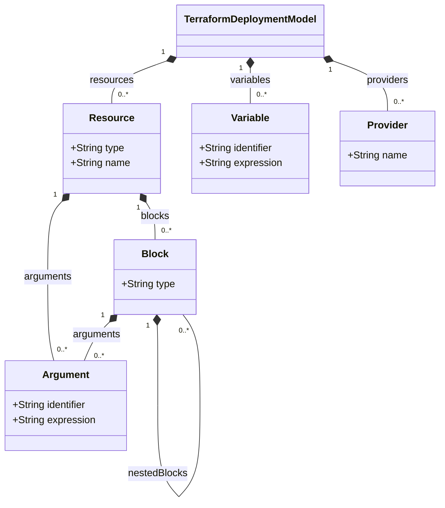

# Terraform Transformations

The Terraform transformation is implemented by two repositories:

- [**terraform-mps-plugin**](https://github.com/UST-DeMAF/terraform-mps-plugin): The DeMAF plugin service that parses the Terraform deployment model (*Step 1: Deployment Model Parser*), runs the MPS transformation, and detects embedded deployment models.
- [**mps-transformation-terraform**](https://github.com/UST-DeMAF/mps-transformation-terraform): The JetBrains MPS project that defines the Terraform metamodel (language `Terraform`) and the generator that implements the *Main M2M Transformation* (Step 2) and the *Model Merger* (Step 3).

## Terraform Metamodel

The following diagram shows the Terraform metamodel as supported by the DeMAF:

The metamodel corresponds to the `Terraform` language of the MPS project.
It represents the generic structure of the Terraform language: the semantics of a resource is defined by its provider, so the resource types are not part of the metamodel.
Provider-specific semantics are added by the transformation rules (see [Step 2](#step-2-main-m2m-transformation)).

## Transformation Process

The transformation follows the four steps of the DeMAF transformation process: the deployment model parser, the main model-to-model (M2M) transformation, the model merger, and the post M2M transformation.

### Step 1: Deployment Model Parser

The parser reads the files with the extensions `.tf` and `.tofu` at the given locations; for a directory, the files directly contained in it are read (subdirectories are not searched).
The files are converted to JSON with the [hcl2json](https://github.com/tmccombs/hcl2json) tool, which is part of the plugin, and the following elements are parsed:

| Terraform element | Parsed into |
| --- | --- |
| `source` of the providers in `terraform { required_providers { ... } }` | `Provider` |
| `resource "<type>" "<name>" { ... }` | `Resource`; nested blocks become `Block`s, all other fields become `Argument`s whose expression is the JSON representation of the value |
| `variable "<name>" { default = ... }` | `Variable` with the default value as expression, or `null` |

If the files contain variables, the variable values given by `-var=<name>=<value>` in `terraform apply` commands of the embedding deployment model (e.g., a Bash script) are added as variables as well.
They take precedence over the default values.

All other elements, such as `data` sources, `module` calls, `provider` blocks, `output`s, `locals`, and `.tfvars` files, are not parsed.

### Step 2: Main M2M Transformation

The plugin serializes the parsed Terraform model to XML, which is imported and transformed into an EDMM model by the generator of the MPS project.

#### Overview of Mappings

| Terraform Construct | EDMM Construct |
| --- | --- |
| Terraform Deployment Model | Base Component Types & Relation Types |
| Resource | Component & Component Type |
| Resource Argument (& Variable) | Component Property |
| Block | Component Property |
| `depends_on` Meta-Argument | connects-to Relation |
| Provider (AWS, Azure, GCP) | Component & hosted-on Relations |
| Provider (Docker) | Component & hosted-on Relations |
| `image` of a `docker_container` Resource | Component Artifact |
| Ignored Resource Types | *not transformed* |

#### Details

##### Terraform Deployment Model

For each transformed Terraform deployment model, the following types are created:

- Relation types `DependsOn`, `HostedOn`, and `ConnectsTo`, where `HostedOn` and `ConnectsTo` are derived from `DependsOn`.
- Component types `BaseType`, `SoftwareApplication` (derived from `BaseType`), `DatabaseSystem` (derived from `SoftwareApplication`), `ContainerPlatform` (derived from `BaseType`), and `KubernetesCluster` (derived from `ContainerPlatform`).
- If the model uses a supported cloud provider: the component type `CloudProvider` (derived from `BaseType`).

Component types that are not used by any component and are not the parent type of a used component type are removed after the transformation.

##### Resource

Each resource whose type is not ignored (see [Ignored Resource Types](#ignored-resource-types)) is mapped to:

- A **component** with the name of the resource. If several resources have the same name, the component name is extended to `<resource name>_<resource type>`.
- A **component type** with the name of the resource type, e.g., `google_container_cluster`. Resources of the same type share their component type, which contains the properties of all these resources. The parent type depends on the resource type:

| Resource types | Parent type |
| --- | --- |
| `aws_eks_cluster`, `azurerm_arc_kubernetes_cluster`, `azurerm_kubernetes_cluster`, `google_container_cluster` | `KubernetesCluster` |
| `azurerm_cosmosdb_cassandra_datacenter`, `azurerm_cosmosdb_gremlin_database`, `azurerm_cosmosdb_mongo_database`, `azurerm_cosmosdb_sql_database`, `azurerm_hpc_cache`, `azurerm_kusto_database`, `azurerm_mssql_database`, `azurerm_mssql_managed_database`, `azurerm_mysql_flexible_database`, `azurerm_oracle_autonomous_database`, `azurerm_postgresql_database`, `azurerm_postgresql_flexible_server_database`, `azurerm_redis_cache`, `azurerm_redis_enterprise_database` | `DatabaseSystem` |
| all other resource types | `BaseType` |

Thus, a Kubernetes cluster created by Terraform is recognized as the cluster that hosts the components of an embedded Kubernetes deployment model (see [Kubernetes: Step 4](Kubernetes.md#step-4-post-m2m-transformation)).

##### Resource Argument and Variable

Each argument of a resource is mapped to a **component property** with the argument identifier as key.
For the value, references in the expression are resolved:

- A variable reference `var.<name>` is replaced by the value of the variable.
- A reference to another resource `<type>.<name>.<argument>` is replaced by the value of that argument. Arguments of blocks are referenced by their path, e.g., `<type>.<name>.<block>.<argument>`.
- A reference to the result of a resource of the Random provider (`random_*.result`) is replaced by a placeholder, e.g., `generatedRandomString` or `generatedRandomPassword`.
- An interpolation `${...}` is unwrapped before resolving it.

Expressions that cannot be resolved are kept as they are.

##### Block

The arguments of a block are mapped to **component properties** whose keys are the argument identifiers prefixed with the block type, e.g., `node_config.machine_type` for the argument `machine_type` in the block `node_config`.
The arguments of nested blocks are prefixed accordingly.

##### `depends_on` Meta-Argument

For each resource referenced in the `depends_on` meta-argument of a resource, a **connects-to relation** `<source>_ConnectsTo_<target>` is created from the component of the resource to the component of the referenced resource, if the referenced resource exists and its type is not ignored.

##### Provider (AWS, Azure, GCP)

The supported cloud providers are mapped to a **component** of type `CloudProvider`:

| Provider source | Component name | Resource type prefix |
| --- | --- | --- |
| `hashicorp/aws` | `AWS` | `aws_` |
| `hashicorp/azurerm` | `MicrosoftAzure` | `azurerm_` |
| `hashicorp/google` | `GCP` | `google_` |

For each resource whose type starts with the resource type prefix of a used cloud provider, a **hosted-on relation** `<resource name>_HostedOn_<component name>` is created from the component of the resource to the component of the cloud provider.
For example, the resource `google_container_cluster.primary` is hosted on the component `GCP`.

##### Provider (Docker)

If the Docker provider (`kreuzwerker/docker`) is used, the component type `DockerEngine` (derived from `ContainerPlatform`) and a component `DefaultDockerEngine` of this type are created.
They represent the Docker Engine on which the containers are run.

Each `docker_container` resource is mapped as described for [resources](#resource), with the following differences:

- The `image` argument is mapped to an **artifact** of type `docker_image` named after the image, instead of a property.
- Each entry `<key>=<value>` of the `env` argument is mapped to a separate **property** with the key `<key>`.
- The values of the `command` and `healthcheck.test` arguments are converted from a list to a single command string.
- A **hosted-on relation** `<resource name>_HostedOn_DefaultDockerEngine` to the `DefaultDockerEngine` component is created.

##### Ignored Resource Types

Resources of the following types do not describe deployment components and are not transformed:

- `azurerm_resource_group`, `google_service_account`, `docker_network`
- all resource types of the Random provider (`random_*`)
- all resource types of the Kubernetes provider (`kubernetes_*`), except `kubernetes_deployment`, `kubernetes_pod`, and `kubernetes_stateful_set`

The Kubernetes resources are transformed as an embedded Kubernetes deployment model instead (see [Embedded Deployment Models](#embedded-deployment-models)).
The components created from `kubernetes_deployment` and `kubernetes_stateful_set` resources are replaced by the components of the embedded Kubernetes deployment model (see [Kubernetes: Step 3](Kubernetes.md#step-3-model-merger)).

### Step 3: Model Merger

Before merging, the following steps are applied to the transformation result:

- Components with the same name are renamed as described for [resources](#resource), and the names of their relations are updated.
- Component types with the same name are merged into one component type that contains the properties and operations of all of them.
- Unused component types are removed.

Then, the result is merged into the EDMM model of the current transformation process:

- Components with the same name and component type name are merged into one component that contains the properties, operations, and artifacts of both. Relations of the merged components are redirected accordingly.
- All other components and all relations are added.
- Component types and relation types with the same name are merged.

### Step 4: Post M2M Transformation

There is no post M2M transformation.

## Embedded Deployment Models

The DeMAF currently supports the following embeddings of Terraform deployment models, which are described in detail in the [overview of embedded deployment models](README.md#embedded-deployment-models):

- [Bash → Terraform](README.md#bash--terraform) (reference embedding)
- [Terraform → Docker](README.md#terraform--docker) (reference embedding)
- [Terraform → Helm](README.md#terraform--helm) (reference embedding)
- [Terraform → Kubernetes](README.md#terraform--kubernetes) (containment embedding)
