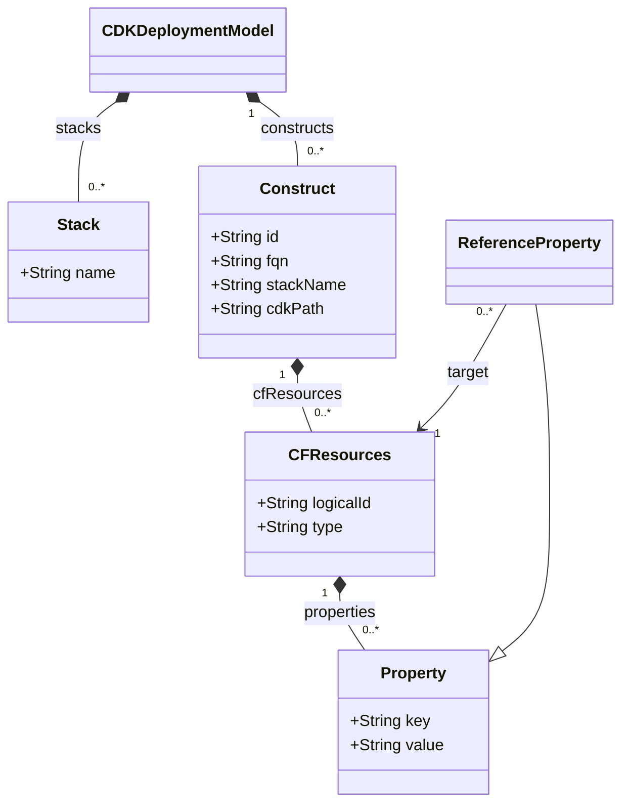

# AWS CDK Transformations

The AWS Cloud Development Kit (CDK) transformation is implemented by two repositories:

- [**cdk-mps-plugin**](https://github.com/UST-DeMAF/cdk-mps-plugin): The DeMAF plugin service that parses the AWS CDK deployment model (*Step 1: Deployment Model Parser*) and runs the MPS transformation.
- [**mps-transformation-awscdk**](https://github.com/UST-DeMAF/mps-transformation-awscdk): The JetBrains MPS project that defines the AWS CDK metamodel (language `AWSCDK`) and the generator that implements the *Main M2M Transformation* (Step 2).

AWS CDK deployment models are written in general-purpose programming languages.
Instead of the source code, the transformation analyzes the output of `cdk synth`, the `cdk.out` directory, which contains the synthesized AWS CloudFormation templates and the construct tree of the CDK application.

## AWS CDK Metamodel

The following diagram shows the AWS CDK metamodel as supported by the DeMAF:

The metamodel corresponds to the `AWSCDK` language of the MPS project.
A `Construct` is an L2 or L3 construct of the CDK application, e.g., a `Function` or a `Bucket`.
Its `CFResources` are the AWS CloudFormation resources it synthesizes to, e.g., an `AWS::Lambda::Function` and its `AWS::IAM::Role`.
A `ReferenceProperty` is a property that references another CloudFormation resource.

## Transformation Process

The transformation follows the four steps of the DeMAF transformation process: the deployment model parser, the main model-to-model (M2M) transformation, the model merger, and the post M2M transformation.

### Step 1: Deployment Model Parser

The parser expects a `cdk.out` directory as location and reads the following files:

- `manifest.json`: The stacks (artifacts of type `aws:cloudformation:stack`) and the paths of their CloudFormation templates. Other artifacts are ignored.
- `tree.json`: The construct tree. Each direct child of a stack node is a construct, unless it is CDK bookkeeping (`CDKMetadata`, `BootstrapVersion`, `CheckBootstrapVersion`, `Tree`), the handler of a custom resource (id starting with `Custom::`), a CloudFormation control element (`CfnParameter`, `CfnOutput`, `CfnRule`, `CfnCondition`, `CfnMapping`), or CDK infrastructure (fqn containing `CustomResourceProvider` or `AssetStaging`). The CloudFormation resources of a construct are found by their logical ids (`aws:cdk:cloudformation:logicalId`) in the subtree of the construct.
- The CloudFormation template of each stack: The resources with their properties and the exports of the stack.

The properties of the CloudFormation resources are processed as follows:

- Structured values are flattened into dotted keys up to a depth of 4, e.g., `ContainerDefinitions.0.Image`.
- A property whose value is a single `Ref` or `Fn::GetAtt` becomes a reference property to the referenced resource. A property whose value is a list of references is converted into a comma-separated list of the referenced resources. Other intrinsic functions are kept as they are.
- Each resource listed in the `DependsOn` attribute of a resource becomes a reference property with the key `DependsOn`.

Afterwards, the following resolvers add information to the model:

| Resolver | Added information |
| --- | --- |
| Cross-stack references | Each `Fn::ImportValue` is replaced by the value exported by the producing stack, so that references across stacks become ordinary references. |
| Artifacts | For a resource with container definitions, the image of the first container is added as artifact of type `docker_image`. For a Lambda function with code in S3 (`Code.S3Bucket`, `Code.S3Key`), the package `s3://<bucket>/<key>` is added as artifact of type `file`. |
| IAM connectivity | For each resource that accesses another resource through IAM permissions, i.e., through the policies of the role of a Lambda function, an ECS task, an EC2 instance profile, or a role nested in a property (e.g., of an IoT topic rule), a reference property with the key `ConnectsTo` and the access level (`read`, `write`, `readwrite`, `invoke`, or `reference`) as value is added. Environment variables of Lambda functions and ECS containers that reference a resource are added as `ConnectsTo` references as well. Permissions for `logs`, `xray`, and `sts` and for log groups are ignored. A permission granted on all resources of a service (`*`) adds a resource of the type `AWS::<service>::ManagedService` that represents the service. |
| Connectivity graph | Resources that wire two components together are contracted to `ConnectsTo` references with the access level `invoke` between the components at either end: `AWS::Lambda::Permission`, `AWS::Lambda::EventSourceMapping`, `AWS::ApiGateway::Method`, `AWS::ApiGatewayV2::Route`, `AWS::ApiGatewayV2::Integration`, `AWS::ApiGatewayV2::Authorizer` (access level `reference`), `AWS::ElasticLoadBalancingV2::Listener`, `AWS::ElasticLoadBalancingV2::ListenerRule`, `AWS::ElasticLoadBalancingV2::TargetGroup`, `AWS::SNS::Subscription`, `AWS::Events::Rule`, and `AWS::CloudWatch::Alarm`, among others. Destinations named in an action (`destinationArn`, `targetArn`, `domainName`), e.g., a Kafka cluster an IoT rule writes to, are added as `ConnectsTo` references as well; the origin of a CloudFront distribution is read (`read`). References derived from IAM permissions are not overwritten. |

The `commands` of the analysis task are not used.

### Step 2: Main M2M Transformation

The plugin serializes the parsed AWS CDK model to the XML format of MPS models, which is transformed into an EDMM model by the generator of the MPS project.

#### Overview of Mappings

| AWS CDK Construct | EDMM Construct |
| --- | --- |
| AWS CDK Deployment Model | Base Component Types & Relation Types, `aws` Component |
| CloudFormation Resource (of a supported type) | Component & Component Type, hosted-on Relation |
| Property | Component Property |
| Artifact (`artifactType`, `artifactUri`) | Component Artifact |
| Reference Property | connects-to, depends-on, attaches-to, or hosted-on Relation |
| CloudFormation Resource (of other types) | *not transformed* |

#### Details

##### AWS CDK Deployment Model

For each transformed AWS CDK deployment model, the following types are created:

- Component types `BaseType`, `SoftwareApplication`, `DatabaseSystem` (derived from `SoftwareApplication`), `MessageBroker` (derived from `SoftwareApplication`), `Storage`, `ContainerPlatform`, `KubernetesCluster` (derived from `ContainerPlatform`), `Platform`, `Compute`, and `CloudProvider`. All types without a given parent type are derived from `BaseType`.
- Relation types `DependsOn`, `HostedOn`, `AttachesTo` (with the property `location`), and `ConnectsTo` (with the property `accessLevel`), where all but `DependsOn` are derived from `DependsOn`.

In addition, a component `aws` of type `CloudProvider` is created.

##### CloudFormation Resource

Each CloudFormation resource of a supported type is mapped to a **component** with the logical id of the resource as name.
The supported types are assigned to the following categories:

| Category | CloudFormation resource types |
| --- | --- |
| `Compute` | `AWS::EC2::Instance`, `AWS::Lambda::Function` |
| `SoftwareApplication` | `AWS::ApiGateway::RestApi`, `AWS::ApiGatewayV2::Api`, `AWS::ElasticLoadBalancingV2::LoadBalancer`, `AWS::CloudFront::Distribution`, `AWS::StepFunctions::StateMachine`, `AWS::ECS::Service`, `AWS::ECS::TaskDefinition`, `AWS::Cognito::*`, `AWS::SES::*`, `AWS::*::ManagedService` |
| `Storage` | `AWS::S3::Bucket`, `AWS::EFS::FileSystem`, `AWS::EC2::Volume`, `AWS::Backup::BackupVault`, `AWS::Glacier::Vault` |
| `DatabaseSystem` | `AWS::RDS::*`, `AWS::DynamoDB::Table`, `AWS::DocDB::*`, `AWS::Neptune::*`, `AWS::ElastiCache::*`, `AWS::Redshift::*`, `AWS::Timestream::Database`, `AWS::QLDB::Ledger` |
| `MessageBroker` | `AWS::SQS::Queue`, `AWS::SNS::Topic`, `AWS::IoT::TopicRule`, `AWS::MSK::*`, `AWS::AmazonMQ::*`, `AWS::Events::EventBus`, `AWS::Kinesis*`, `AWS::Pipes::Pipe`, `AWS::Scheduler::Schedule` |
| `ContainerPlatform` | `AWS::ECS::Cluster` |
| `KubernetesCluster` | `AWS::EKS::*` |
| `Platform` | `AWS::ElasticBeanstalk::Environment`, `AWS::AppRunner::Service`, `AWS::Amplify::*` |

The component gets a **component type** `<technology>-<category>` derived from the category type, e.g., `lambda-Compute`, `s3-Storage`, or `postgresql-DatabaseSystem`.
The technology is determined as follows:

- `AWS::RDS::*`: the database engine (`Engine` property): `postgresql` for Aurora PostgreSQL and PostgreSQL, `mysql` for other Aurora engines, `oracle`, `sqlserver`, or the engine name; `rds` if no engine is given.
- `AWS::ElastiCache::*`: the engine `valkey`, `memcached`, or `redis`, or the engine name; `elasticache` if no engine is given.
- `AWS::DocDB::*`: `mongodb`.
- `AWS::EC2::*`: the resource name, e.g., `instance` or `volume`.
- all other types: the service name, e.g., `lambda`, `s3`, or `dynamodb`.

If a component has no hosting reference (see [Reference Property](#reference-property)), a **hosted-on relation** `<logical id>_HostedOn_aws` to the `aws` component is created.

CloudFormation resources of other types, e.g., IAM roles and policies, VPCs, subnets, and security groups, are not mapped to components.

##### Property

Each property of a resource is mapped to a **component property** with the same key and value.
A reference property to a VPC or subnet is mapped to a component property whose value is the `CidrBlock` of the referenced resource, or its logical id.

##### Artifact

The artifact added by the parser (see [Step 1](#step-1-deployment-model-parser)) is mapped to an **artifact** of the component with the artifact type (`docker_image` or `file`) and the artifact URI as name and file URI.

##### Reference Property

A reference property between two resources of supported types is mapped to a relation between their components.
The type of the relation is determined in the following order:

| Condition | Relation |
| --- | --- |
| The key of the reference property is `ConnectsTo` | **connects-to relation** `<source>_ConnectsTo_<target>` with the property `accessLevel` |
| The key of the reference property is `DependsOn`, or the target is an `AWS::ECS::TaskDefinition` | **depends-on relation** `<source>_DependsOn_<target>` |
| The target is an `AWS::EC2::Volume` or `AWS::EFS::FileSystem` | **attaches-to relation** `<target>_AttachesTo_<source>` from the storage to the referencing component, with the property `location` set to `/` |
| The target is a `ContainerPlatform` or `KubernetesCluster` | **hosted-on relation** `<source>_HostedOn_<target>` |
| otherwise | **connects-to relation** `<source>_ConnectsTo_<target>` |

### Step 3: Model Merger

There is no model merger.

> [!NOTE]
> The plugin replaces the EDMM model of the transformation process with the transformation result. Thus, components created by other deployment technologies in the same transformation process are not preserved.

### Step 4: Post M2M Transformation

There is no post M2M transformation.

## Embedded Deployment Models

The DeMAF currently supports no embeddings of AWS CDK deployment models.
Possible embeddings are described in the [overview of embedded deployment models](../README.md#embedded-deployment-models).
