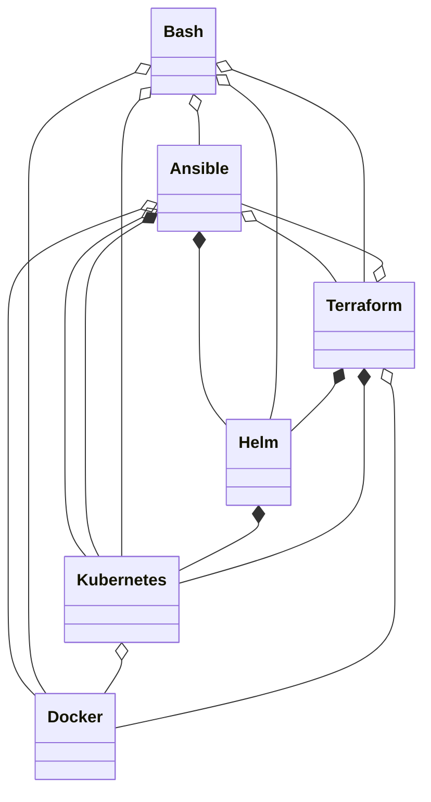

# DeMAF Transformations

This documentation describes in detail the transformations carried out by the DeMAF for each supported deployment technology.
Technology-specific deployment models of these deployment technologies are transfromed into a unified, technology-agnostic deployment model based on the Essential Deployment Metamodel (EDMM).

We currently support the transformation of the following deployment technologies, explained in detail in seperate files:

| Deployment Technology | Transformation Documentation | Dev Version |
| --- | --- | --- |
| Ansible | | |
| Bash | | |
| Docker | | |
| Helm | | |
| Kubernetes | [Kubernetes](/transformations/Kubernetes.md) | [Kubernetes-DEV](/transformations/dev/Kubernetes-dev.md) |
| Terraform | | |
| AWS Cloud Development Kit (CDK) | | |

For some deployment technologies, we provide a dev-version that documents unfinished features.

Each file describes the technology-specific metamodel of the deploment technology, the mappings and transformation rules from this technology-specific metamodel to the EDMM, and which and how embedded deployment models are detected.
In addition, it gives details on how this transformation is carried out. The transformation of most deployment technologies is carried out in 4 general steps:

- Step 1: Deployment Model Parser
- Step 2: Main M2M Transformation
- Step 3: Model Merger
- Step 4: Post M2M Transformation

## EDMM

Here, we describe how the DeMAF implements the Essential Deployment Metamodel (EDMM).
The DeMAF uses a general type system for Component and Relation types that we document in [**DeMAF Type Definitions**](<https://github.com/UST-DeMAF/demaf-type-definitions>).

## Embedded Deploment Models

We distinguish between two different methods by which one deployment model can embed another deployment model:

**Reference Embedding**:
The embedding deployment model references an external location where the embedded deployment model is defined (for example, a file).

**Containment Embedding**:
The embedded deployment model is specified  directly in the embedding deployment model. The deployment technology of the embedding deployment model may provide means to specify elements of the embedded deployment models DSL.

A deployment technology can provide means to embed deployment models using either one or both of these methods.
The following diagram shows an overview of the methods provided by the deployment technologies to embed deployment models and which embeddings can curently be detected by the DeMAF (reference embeddings are denoted as aggregations, and containment embeddings are denoted as compositions):

